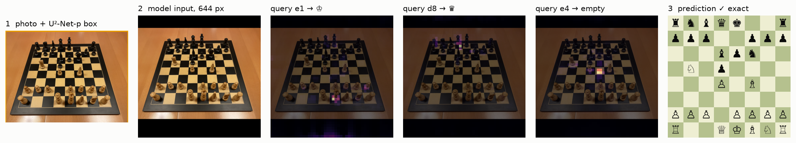
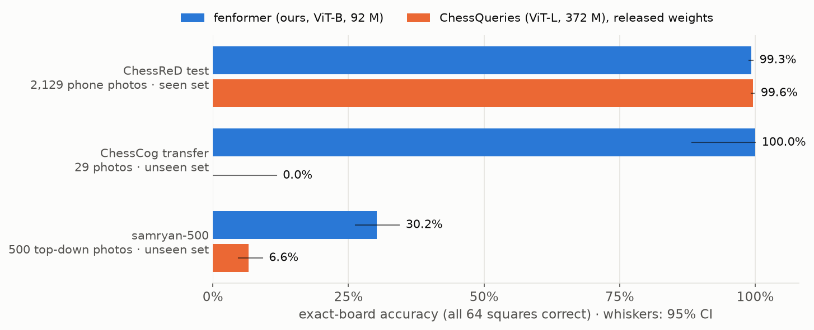
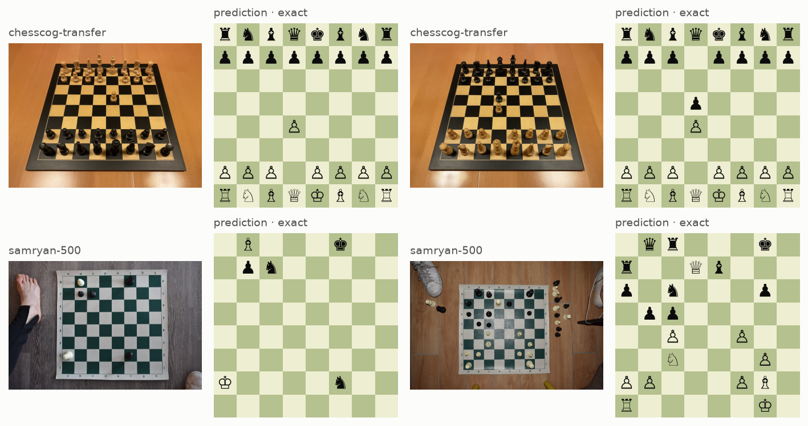
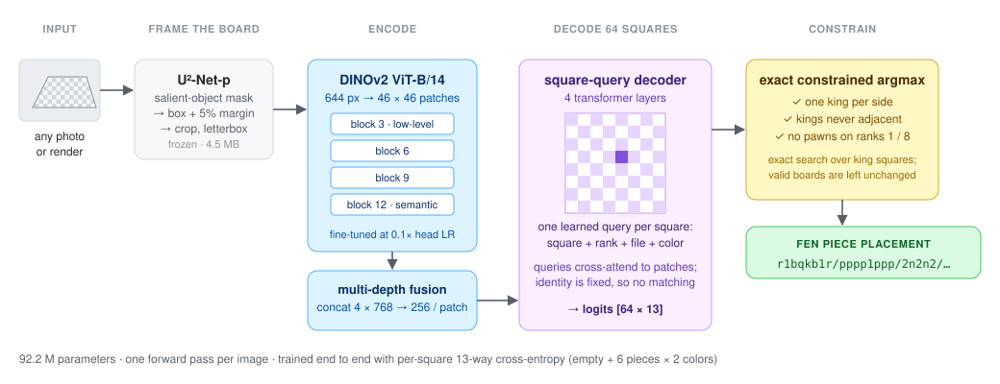
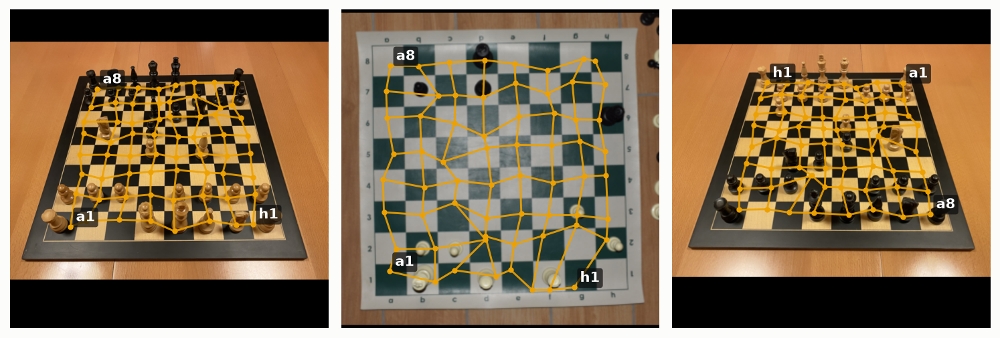
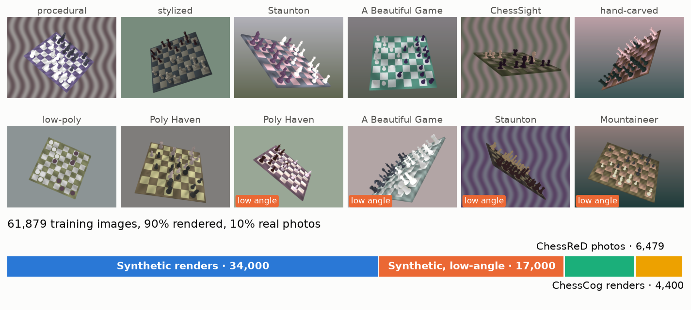
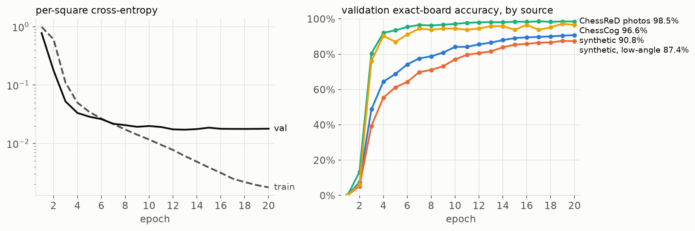
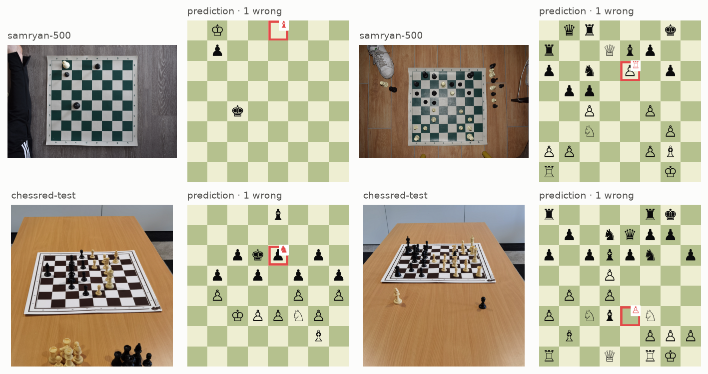

<h1 align="center">fenformer</h1>

<p align="center">
  <b>Read a chess position from one photo of a real 3D board.</b><br>
  One 92 M-parameter network, no hand-built board detection, trained on 82% synthetic data.
</p>

<p align="center"></p>

## Results

The test that matters is a chess set the model has never seen. On two public photo sets
of unseen physical boards, fenformer reads **29 of 29** and **30.2%** of boards perfectly.
The released ChessQueries model, a ViT-L four times larger and the state of the art on
ChessReD, reads **0 of 29** and **6.6%** of the same images.

<p align="center"></p>

| Benchmark | Images | fenformer | ChessQueries ViT-L (released) |
| --- | ---: | ---: | ---: |
| ChessCog transfer, **unseen set** | 29 | **100%** [88.3, 100] | 0.0% [0, 11.7] |
| samryan-500, **unseen set**, top-down | 500 | **30.2%** [26.3, 34.4] | 6.6% [4.7, 9.1] |
| ChessReD test (seen set, unseen games) | 2,129 | 99.30% [98.8, 99.6] | 99.62% [99.3, 99.8] |
| ChessCog test (seen renders) | 342 | 95.32% [92.5, 97.1] | — |

Exact-board accuracy: all 64 squares right, with 95% Wilson intervals. Both models use the
same constrained decoding (below). On ChessReD, the one benchmark both were trained for, the
two are within noise of each other. Square accuracy, wrong squares per board, and the
prediction for every image are in [`results/`](results). No test image was used for
training, model selection or tuning.

<p align="center"></p>

## How it works

<p align="center"></p>

**Frame, encode, ask each square.** A frozen salient-object model (U²-Net-p, 4.5 MB) crops
the board with a 5% margin. DINOv2 ViT-B/14 encodes the 644 px crop, and features from
four depths are concatenated per patch, giving the head both fine edges and semantics.
Then 64 learned queries, one per square, cross-attend to the patches through a 4-layer
transformer decoder and each predicts one of 13 classes.

**Why square queries.** Classical pipelines detect corners, rectify the board and classify
cropped squares, which breaks under occlusion, low angles and unusual sets. Here, square
identity is built into each query (a learned embedding plus shared rank, file and color
embeddings), so the network must *find* its square. It does: connecting each query's
attention peak recovers a perspective-correct grid, including which side White sits on
(right: the camera is behind Black, and a1 is top right).

<p align="center"></p>

**Exact constrained decoding.** Per-square argmax can output two white kings. Fixing the two
king squares makes every other square independent, so the best board with one king per
side, non-adjacent kings and no pawns on the back ranks is an exact 64 × 64 search.
Valid argmax boards pass through unchanged.

**What each part buys.** Measured on the same weights, removing one part at a time:

| Exact boards | ChessReD test | ChessCog test | ChessCog transfer | samryan-500 |
| --- | ---: | ---: | ---: | ---: |
| fenformer | **99.30%** | 95.32% | **100%** | **30.2%** |
| without framing (whole photo) | 98.68% | **96.49%** | **100%** | 17.6% |
| without constrained decoding | **99.30%** | 95.32% | **100%** | 29.6% |

Framing matters most where the board fills a small part of the photo (samryan-500); it
costs 1.2 points on ChessCog renders. Constrained
decoding only changes boards the network gets illegally wrong, which is rare in-domain.

## Data: diversity over realism

<p align="center"></p>

Rendering is cheap; matching a specific camera is not. The renderer randomizes everything
that should not matter (10 piece-mesh families, materials, lighting, background, full
360° orbit, ±45° roll, many low-angle views) over real Lichess game positions. A small
share of real and third-party images anchors the photo domain. Provenance, splits and
licenses: [`docs/data.md`](docs/data.md).

## Training

<p align="center"></p>

One A100-80GB, 20 epochs in 5.3 h, about $19. AdamW, head LR 1e-4 and encoder LR 1e-5
(pretrained features move slowly), 2 warmup epochs then cosine, weight decay 0.05, batch
64, bf16, gradient clipping at 1.0, mild photometric and geometric augmentation. The
checkpoint with the most exact validation boards is kept: validation loss flattens after
epoch 9 while exact boards keep climbing from 82% to 91%, because the loss averages over
squares and the remaining errors are a few confident ones. Seeded loaders, deterministic
kernels, and every run resumes from `last.pt`
([config](results/fenformer/training_config.json),
[per-epoch metrics](results/fenformer/training_metrics.json)).

## Where it fails

<p align="center"></p>

samryan-500 is the hard case: a vinyl board shot straight down by a DSLR. The training
cameras stop at 75° elevation, and from directly above a bishop, a rook and a pawn are all
a round top. That is where the errors come from:

- **60% of wrong squares are the wrong piece type, 1% the wrong color.** The model finds the
  board and the pieces; it misreads their shape.
- **30% of all wrong squares are a bishop or rook read as a pawn**, the single largest
  confusion.
- The other 39% are a piece missed or an empty square read as a piece.

Even so, 95.7% of samryan squares are right (ChessQueries: 77.0%) and the median board has
2 errors. The fix is data, not architecture: render overhead cameras. On the seen domains,
the few remaining errors (48 squares in 2,129 ChessReD boards) are mostly a pawn missed or
invented.

## Use it

```bash
uv sync
uv run python -m fenformer.predict board.jpg      # downloads the weights on first use
# rnbqkbnr/pppppppp/8/8/3P4/8/PPP1PPPP/RNBQKBNR	board.jpg
```

Weights: [huggingface.co/Eric-Xia/fenformer](https://huggingface.co/Eric-Xia/fenformer)
(safetensors, pinned by commit and checked against a SHA-256 hash).

Reproduce the benchmarks and training:

```bash
uv run python scripts/prepare_benchmarks.py                     # zero-shot photo sets
uv run python -m fenformer.evaluate --output results/fenformer data/benchmarks/*
modal run modal_app.py --run my-run                              # train on one A100
uv run pytest                                                    # 26 tests
```

## Layout

```text
src/fenformer/
  board.py      FEN <-> 64 class labels
  localize.py   U²-Net-p framing, shared by training and inference
  model.py      DINOv2 encoder, multi-depth fusion, square-query decoder
  decode.py     exact constrained decoding
  data.py       mixture and benchmark datasets
  augment.py    training augmentation
  train.py      training loop
  evaluate.py   benchmark metrics with 95% Wilson intervals
  predict.py    command-line inference
modal_app.py    cloud training and evaluation
scripts/        benchmark preparation, baseline, figures
results/        metrics and per-image predictions behind every number above
```

## Acknowledgements

DINOv2 (Meta AI) via timm; U²-Net-p (Qin et al.) from the rembg release; ChessReD
(Masouris & van Gemert); ChessCog (Wölflein & Arandjelović); samryan18/chess-dataset;
ChessQueries (Seytre) for the released baseline weights. Mesh and dataset licenses are
listed in [`docs/data.md`](docs/data.md).
